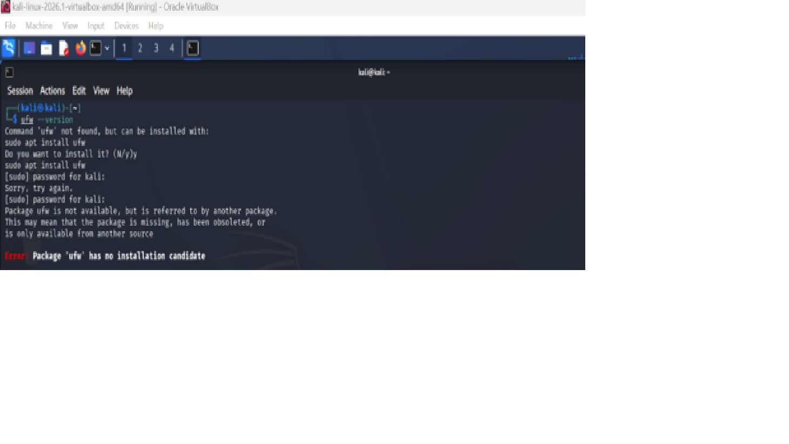
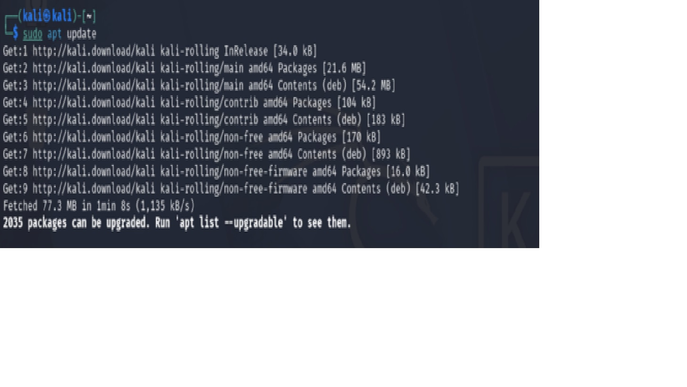
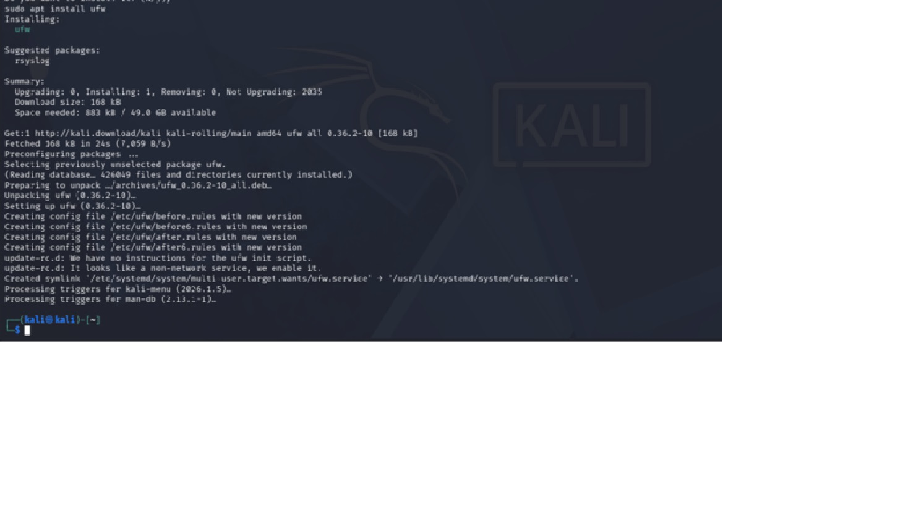
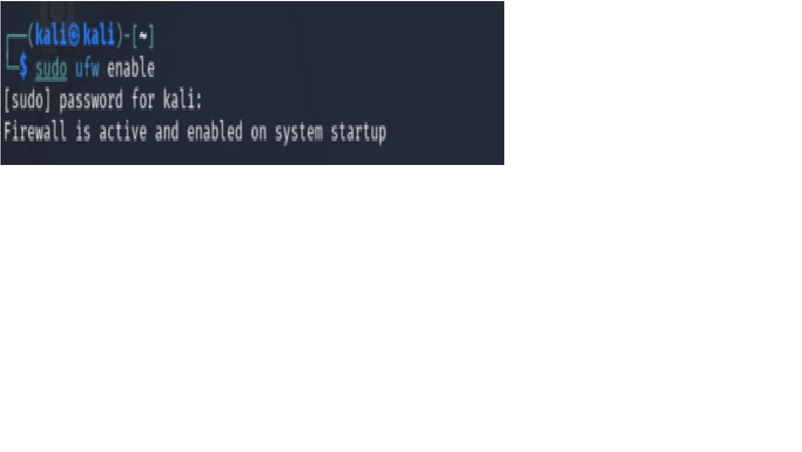
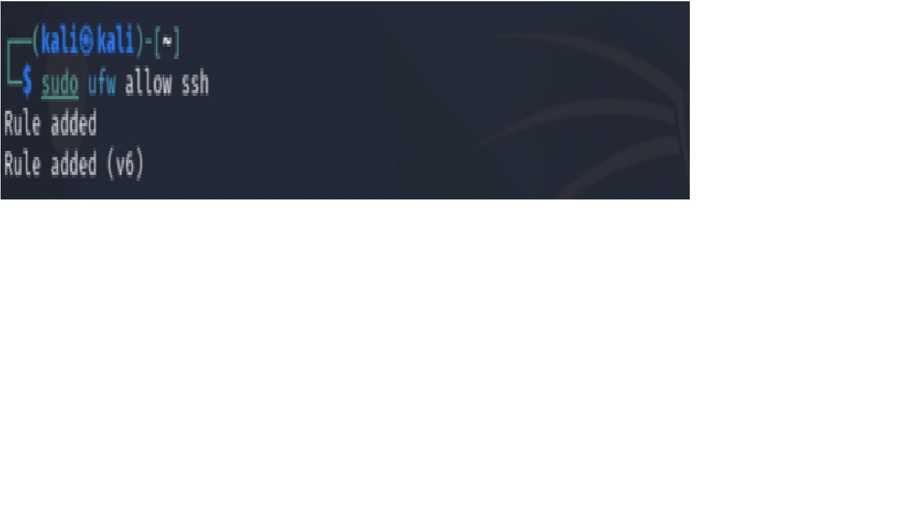
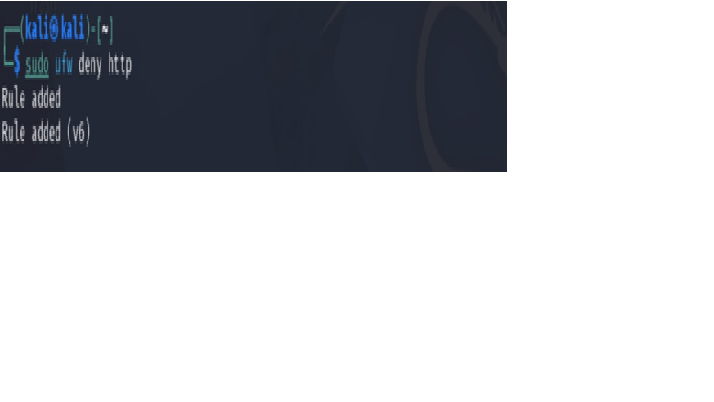
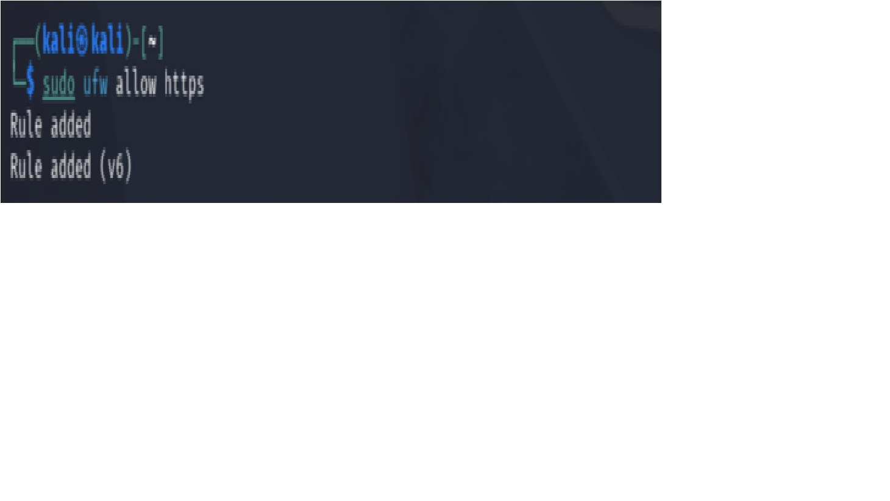
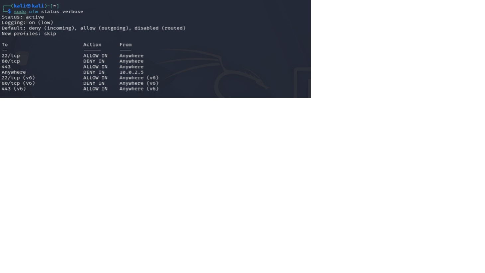

# Task 2: Basic Firewall Configuration with UFW

# Objective

Set up and configure a basic firewall on a Linux system using UFW (Uncomplicated Firewall), applying rules to allow and deny specific types of traffic.

# Tech Stack / Tools

- UFW
- Linux (Metasploitable 2 or Kali Linux in a VM)

# Check Whether UFW Is Installed

Open your Kali Linux terminal and run: ufw --version

# Install UFW if not already present, run: sudo apt install ufw

# Enable UFW: sudo ufw enable

# Configure rule to allow SSH traffic (port 22): sudo ufw allow ssh

# Configure rule to deny HTTP traffic (port 80): sudo ufw deny http

# Add at least 2 additional rules of your choice (e.g., allow HTTPS, deny a specific IP range)
# Sudo ufw allow https

# Sudo ufw deny from 10.0.2.5

# Verify active rules: sudo ufw status verbose

# 9.	Test that denied traffic is actually blocked 

# curl -v --connect-timeout 5 http://10.0.2.4

# Create a ufw_configuration.sh Script That Applies All Your Rules in Sequence (Runnable Script)

# UFW Configuration Script

# script `ufw_configuration.sh` was created to automate the process of firewall configuration.

# Script

# UFW Configuration Script
- sudo apt install -y ufw
- sudo ufw --force enable
- sudo ufw allow ssh
- sudo ufw deny http
- sudo ufw allow https
- sudo ufw deny from 10.0.2.5
- sudo ufw status verbose
- curl -v --connect-timeout 5 http://10.0.2.4

# Execution
# This script was used to execute it.
chmod +x ufw_configuration.sh

- Run the script:

- ./ufw_configuration.sh

# Verification

# To verify, run this on kali VM
- sudo ufw status verbose
- And run this on Metasploitable 2 VM  
- curl -v --connect-timeout 5 http://10.0.2.4

