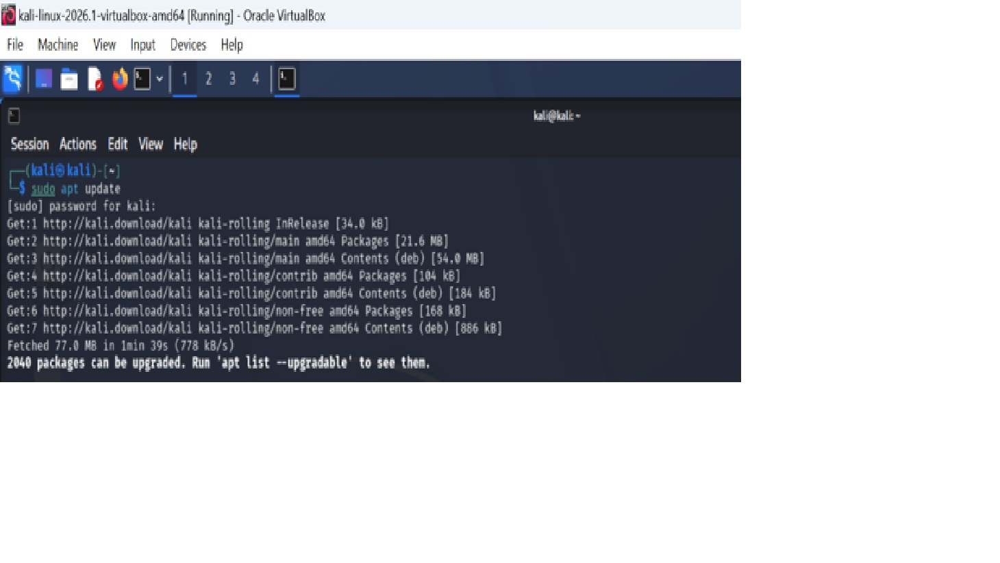
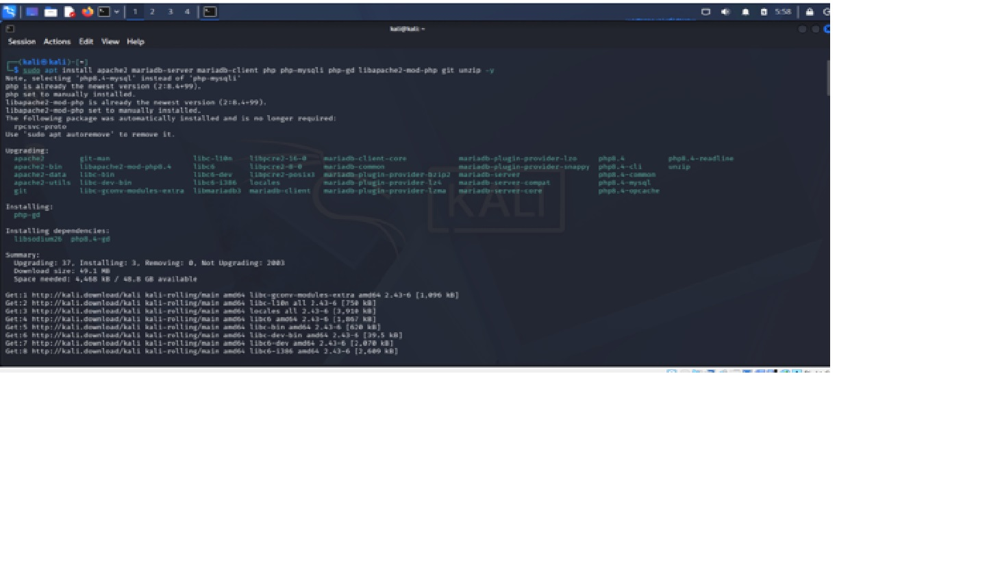
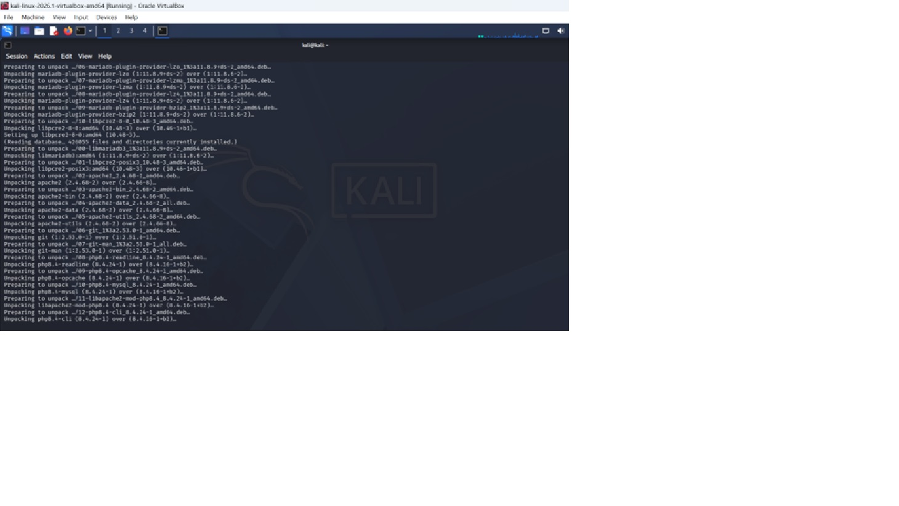
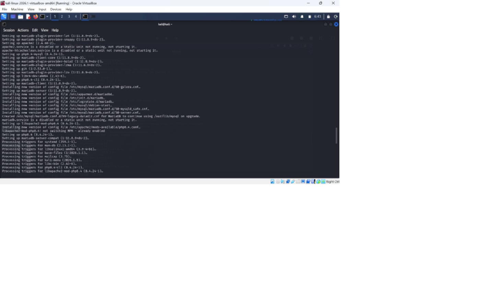
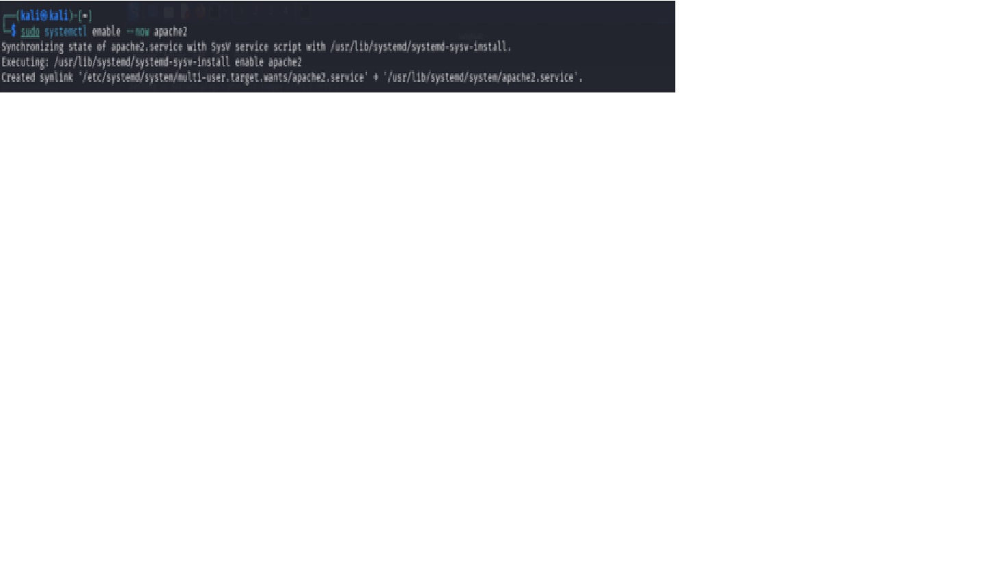
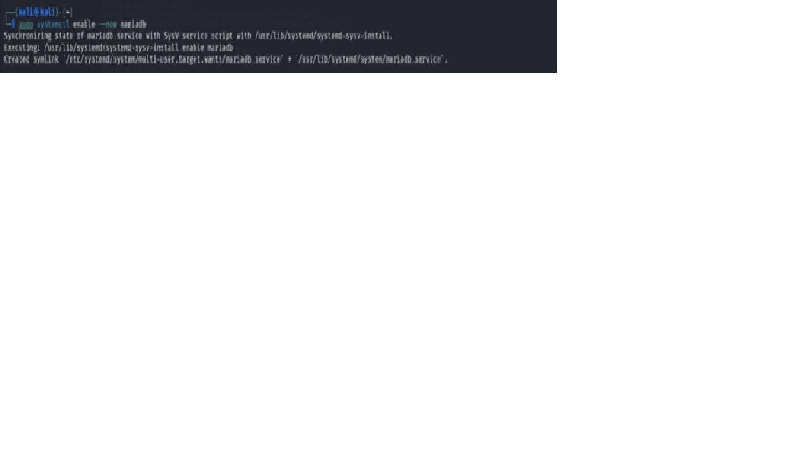
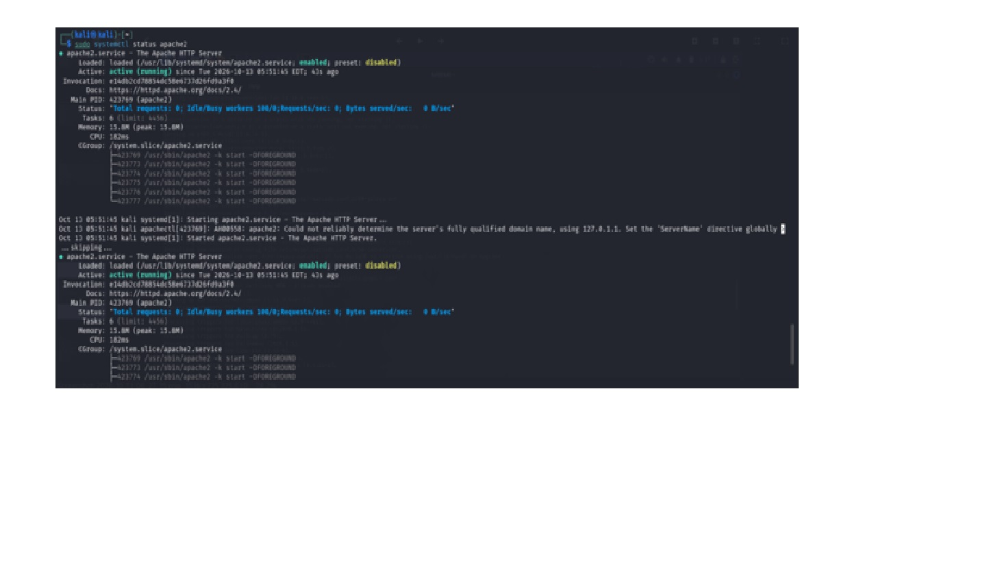
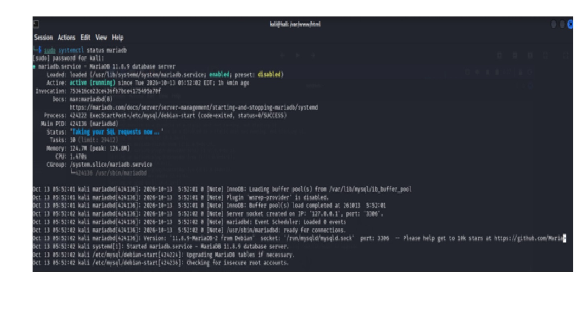
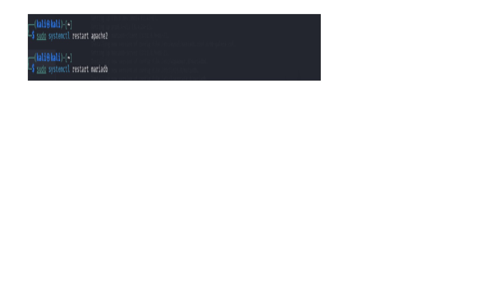

# TASK 3 · SQL Injection on DVWA (Low Security) 

## Objective

The objective of this lab is to demonstrate SQL Injection vulnerability by exploiting the login form of DVWA (Damn Vulnerable Web Application) on its Low security setting and document the attack with an explanation of how it works and how to prevent it.

## Tech Stack / Tools

- DVWA (Damn Vulnerable Web Application)
- XAMPP or LAMP (for this lab, i used LAMP on kali linux VM)
- Web Browser

# Install and configure DVWA on a local server (using LAMP on Kali Linux )

## Update before beginning the installation process

### sudo apt update

### sudo apt install apache2 mariadb-server mariadb-client php php-mysqli php-gd libapache2-mod-php git unzip -y

### sudo systemctl enable --now apache2

### sudo systemctl enable --now mariadb

### sudo systemctl status apache2

### sudo systemctl status mariadb

### sudo systemctl  restart apache2 and mariadb

### sudo git clone https://github.com/digininja/DVWA.git dvwa

## screenshot

## Navigate to cd /var/www/html/dvwa/config to copy the config file using 
## sudo cp config.inc.php.dist config.inc.php

## screenshot

## Create database using sudo mysql 

## screenshot

## Grant Permissions:
## sudo chmod -R 777 /var/www/html/dvwa/hackable/uploads
## sudo chmod -R 777 /var/www/html/dvwa/config

## screenshot

## sudo systemctl  restart apache2 and mariadb

## screenshot

## Click on create/reset database in this dvwa page

## screenshot

## Login with default username and password

## screenshot

## Set DVWA security level to Low 

## screenshot

## What is SQL Injection? 

SQL Injection is a web application vulnerability that occurs when user input is not properly validated or sanitised before being included in an SQL query. An attacker can insert malicious SQL code into an input field to manipulate the database and gain access to information that should not be available. 

## Why This Payload Works

This condition is always true. When the application inserts the payload into the SQL query without validating it, the query returns all records instead of only the requested record.

The # character comments out the remaining part of the SQL statement, this prevents any injected query or attack to succeed.

## Data Exposed 

The SQL Injection attack exposed user records stored in the DVWA database. Information returned included:
- User IDs
- First Names
- Surnames

The application returned multiple records from the database instead of displaying a single user's information.
  
## How to Fix This Vulnerability

Developers can prevent SQL Injection by using parameterised queries (prepared statements) instead of directly inserting user input into SQL queries.

## An Example of a vulnerable statement
$query = "SELECT * FROM users WHERE id = '$id'";

## Secure Example Using Prepared Statements
$stmt = $conn->prepare("SELECT * FROM users WHERE id = ?");
$stmt->bind_param("i", $id);
$stmt->execute();
$result = $stmt->get_result();

The ? is a parameter placeholder. The value is supplied separately, preventing it from changing the SQL query's structure.

Other security measures that can be taken are:
-	Validate user input
-	Applying the principle of least privilege to database accounts ie giving only the necessary access that each user requires.
-	Escaping user-supplied data where appropriate to prevent syntax error

## Conclusion
This exercise demonstrated how SQL Injection can be used to bypass codes that were used to set up an application and retrieve information that wasn’t authorized from a database.
The vulnerability exists because user input is incorporated directly into SQL queries without proper validation or parametrization. 
