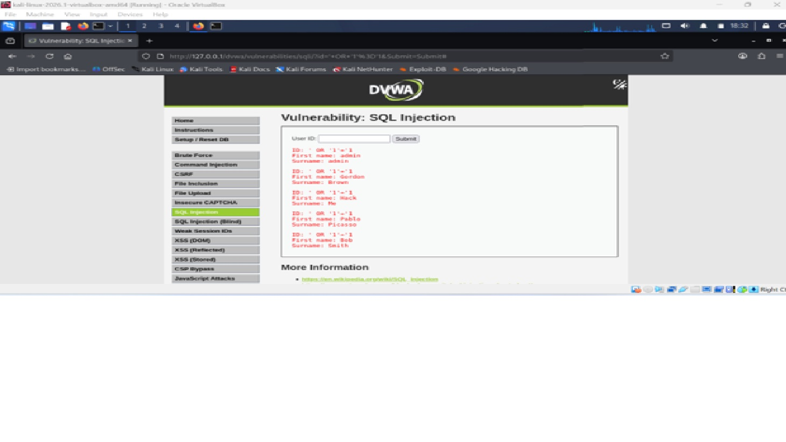

# SQL Injection Notes and Payload Analysis

## 1. Details of the Lab

- **Application:** Damn Vulnerable Web Application (DVWA)
- **Operating System:** Kali Linux
- **Web Server:** Apache2
- **Database:** MariaDB
- **Module:** SQL Injection
- **Security Level:** Low
- **Environment:** Authorized testing lab (DVWA)

## Purpose of Testing

The purpose of this exercise was to show how the DVWA SQL Injection module responds when normal input and different SQL injection payloads are used. I recorded the results and analyzed what happens when user input is not handled properly and how this can adversely affect database queries.

## Payload Log
### Test 1: 
### Payload:

' OR '1'='1 #

## Analysis

This payload exploits the SQL Injection vulnerability by inserting a condition that always evaluates to true.
The expression:'1'='1'

is always true, causing the database to ignore the search condition that you want to use and return all records from the user’s table.

The OR operator changes the original SQL query so that any record that satisfies the condition is returned.

As a result of this, the application disclosed multiple user records instead of information for a single user. This demonstrated that user input was not properly validated or sanitized before including it in the SQL query.

## Result Observed

## Data exposed: 

The following information was exposed:
-	User IDs
-	First Names
-	Surnames

| User ID | First Name | Surname |
|----------|------------|----------| 
| 1 | admin | admin |
| 2 | Gordon | Brown | 
| 3 | Hack | Me | 
| 4 | Pablo | Picasso | 
| 5 | Bob | Smith |

### Test 2: 
### Payload:

' OR 'a'='a' #

## Analysis: 
The expression 'a'='a' is always true. In MySQL/MariaDB, '#' can mark the rest of a line as a comment. 

This payload exploits the SQL Injection vulnerability by inserting a condition that always evaluates to true.
The expression:'a'='a'

is always true, causing the database to ignore the search condition that you want to use and return all records from the user’s table.

The OR operator changes the original SQL query so that any record that satisfies the condition is returned.

As a result of this, the application disclosed multiple user records instead of information for a single user. This demonstrated that user input was not properly validated or sanitized before including it in the SQL query.

## Result Observed

# screenshot

## Data exposed: 

## The following information was exposed:
-	User IDs
-	First Names
- Surnames

| User ID | First Name | Surname | 
|----------|------------|----------| 
| 1 | admin | admin | 
| 2 | Gordon | Brown | 
| 3 | Hack | Me | 
| 4 | Pablo | Picasso | 
| 5 | Bob | Smith |

### Test 3: 
### Payload:

1' OR '2'='2' #

## Analysis

This payload exploits the SQL Injection vulnerability by injecting a condition that always evaluates to true.
The expression: '2'='2'
always returns TRUE. When the payload is inserted directly into an SQL query without validating or sanitizing the input, the query logic will be altered.

The OR operator causes the query to return records whenever either condition is true. Since '2'='2' is always true, the database returns all available records instead of one single record.

The # character comments out the other part of the SQL statement, this prevents syntax errors and allows the injected query to execute successfully.

## Result Observed

# screenshot

## Data exposed: 

## The following information was exposed:
-	User IDs
-	First Names
- Surnames

| User ID | First Name | Surname | 
|----------|------------|----------| 
| 1 | admin | admin | 
| 2 | Gordon | Brown | 
| 3 | Hack | Me | 
| 4 | Pablo | Picasso | 
| 5 | Bob | Smith |
